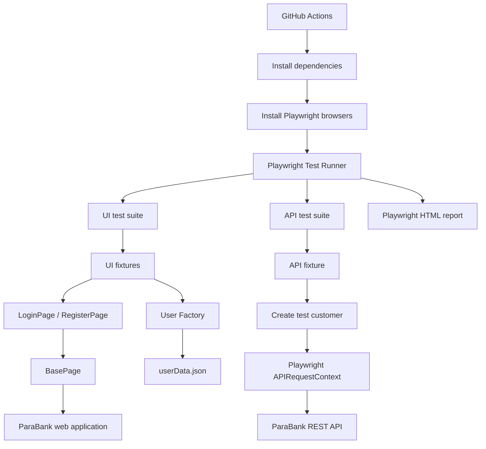

# parabank-playwright-automation

End-to-end test automation for the [ParaBank demo banking application](https://parabank.parasoft.com/parabank/), using Playwright and JavaScript.

The project covers the main registration and login flows through the browser. It also tests customer and account operations through ParaBank's REST API.

## Tech stack

| Tool | Purpose |
|---|---|
| JavaScript | Test and framework code |
| Playwright Test | Test runner, browser automation, and API requests |
| Page Object Model (POM) | Keeps page actions and locators separate from test cases |
| Playwright fixtures | Shares page objects and prepares test users |
| GitHub Actions | Runs the test suite on pushes and pull requests |
| Playwright HTML Reporter | Creates a report after test execution |

## What is covered

### UI tests

The UI tests are located in `tests/ui/`.

| Test file | Scenario |
|---|---|
| `login.spec.js` | Login with valid credentials |
| `login.spec.js` | Reject invalid login credentials |
| `register.spec.js` | Register a new customer |
| `register.spec.js` | Reject a username that already exists |

The UI fixtures create a new user when a test needs an existing account. The fixture registers the user through the website, checks that the user is logged in, then logs out before passing the user data to the test.

### API tests

The API tests are located in `tests/api/`. They use Playwright's `request` fixture to send HTTP requests to ParaBank's REST API.

| Test file | Scenario |
|---|---|
| `auth.spec.js` | Login with valid credentials and verify the returned customer |
| `auth.spec.js` | Reject invalid login credentials |
| `customer.spec.js` | Retrieve a customer by ID |
| `customer.spec.js` | Check the response for an unknown customer ID |
| `customer.spec.js` | Update a customer's city and verify the saved value |
| `accounts.spec.js` | Retrieve a customer's accounts and check the initial checking account |
| `accounts.spec.js` | Retrieve an account by ID |
| `accounts.spec.js` | Create a savings account and verify it appears in the account list |

The API fixture creates a new customer before the tests run. It first opens the registration page to establish a server session, submits the registration form, and then logs in to retrieve the customer's ID.

## Project structure

```text
parabank-playwright-automation/
│
├── .github/
│   └── workflows/
│       └── playwright.yml
│
├── data/
│   ├── userData.json
│   └── userFactory.js
│
├── fixtures/
│   ├── api.js
│   └── index.js
│
├── pages/
│   ├── AccountsOverviewPage.js
│   ├── BasePage.js
│   ├── LoginPage.js
│   └── RegisterPage.js
│
├── tests/
│   ├── api/
│   │   ├── accounts.spec.js
│   │   ├── auth.spec.js
│   │   └── customer.spec.js
│   │
│   └── ui/
│       ├── login.spec.js
│       └── register.spec.js
│
├── .gitignore
├── package.json
├── package-lock.json
├── playwright.config.js
└── README.md
```

## Project map

The project has two test paths: UI tests use page objects and browser fixtures, while API tests use a separate fixture and Playwright's API request context.



### How the main parts work together

- **Tests:** Contain the test scenarios and assertions.
- **Pages:** Keep browser actions in page classes. `BasePage` contains shared methods such as navigation, typing, clicking, and reading text.
- **Fixtures:** Set up page objects and prepare registered users for UI and API tests.
- **Data:** `userData.json` contains the base user data. `userFactory.js` generates a unique username for each new test user.
- **Configuration:** `playwright.config.js` defines the UI and API projects, base URLs, timeouts, retries, and reporting.
- **GitHub Actions:** Installs the project dependencies and browsers, runs the tests, and uploads the HTML report.

## Getting started

### Prerequisites

- Node.js (LTS recommended)
- npm
- Git

### Installation

Clone the repository:

```bash
git clone https://github.com/ramibentaieb-qa/parabank-playwright-automation.git
```

Move into the project directory:

```bash
cd parabank-playwright-automation
```

Install dependencies:

```bash
npm ci
```

Install the Chromium browser used by the UI project:

```bash
npx playwright install chromium
```

## Running the tests

Run the complete test suite:

```bash
npm test
```

Run only the UI tests:

```bash
npm run test:ui
```

Run only the API tests:

```bash
npm run test:api
```

Open the latest HTML report:

```bash
npm run report
```

## Playwright configuration

The configuration is in `playwright.config.js`.

| Setting | Current configuration |
|---|---|
| Test directory | `./tests` |
| UI project | `./tests/ui` |
| API project | `./tests/api` |
| UI browser | Desktop Chrome (Chromium) |
| UI base URL | `https://parabank.parasoft.com` |
| API base URL | `https://parabank.parasoft.com/parabank/services/bank/` |
| Parallel execution | Enabled |
| Retries | 2 in CI, 0 locally |
| Workers | 1 in CI, Playwright default locally |
| Assertion timeout | 15 seconds |
| Action timeout | 15 seconds |
| Navigation timeout | 30 seconds |
| Screenshot | On failure |
| Trace | On first retry |
| Reporters | List and HTML |

The UI and API tests are configured as separate Playwright projects. This makes it possible to run either group without running the other.

## Continuous integration

GitHub Actions runs the Playwright suite when code is pushed to, or a pull request targets, the `main` or `master` branch.

The workflow is defined in `.github/workflows/playwright.yml`.

It performs these steps:

1. Checks out the repository.
2. Sets up Node.js using the current LTS release.
3. Installs dependencies with `npm ci`.
4. Installs Playwright browsers and their system dependencies.
5. Runs the test suite with `npx playwright test`.
6. Uploads the Playwright HTML report as an artifact, with a 30-day retention period.

You can find the workflow runs in the repository's **Actions** tab.

## Notes

- The tests use the public ParaBank demo application, so execution depends on that service being available.
- The user factory generates a different username for each test user to reduce conflicts with previously registered accounts.
- The UI and API fixtures create their own test users. They do not share the same browser or API session.
- The current UI project is configured for Chromium. Firefox and WebKit are not configured as projects.
- `AccountsOverviewPage.js` is present in the repository, but it is currently empty and is not used by the listed tests.
- The current automated coverage focuses on registration, authentication, customer details, and account creation. Fund transfers and bill payments are not covered by the test files currently in the repository.

## Author

**Rami Ben Taieb**

GitHub: [ramibentaieb-qa](https://github.com/ramibentaieb-qa)