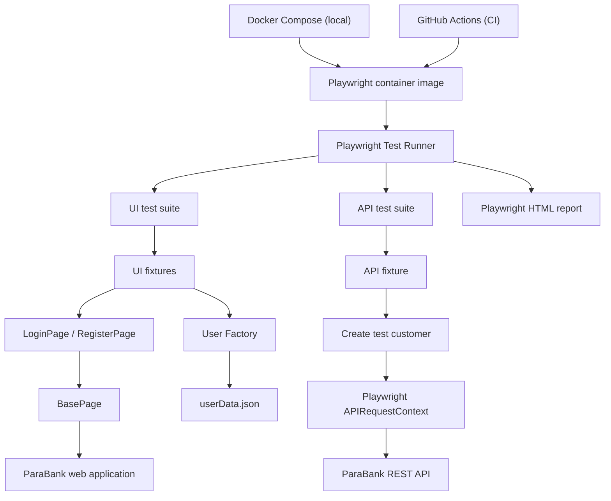

[](https://github.com/ramibentaieb-qa/parabank-playwright-automation/actions/workflows/playwright.yml)

# parabank-playwright-automation

End-to-end and API test automation for the [ParaBank demo banking application](https://parabank.parasoft.com/parabank/), built with Playwright and JavaScript.

The browser tests cover registration and login. The API tests cover customer and account operations through ParaBank's REST API. I built the project to practice Playwright, JavaScript and API testing. The suite runs locally, in Docker, and on GitHub Actions.

## Tech stack

| Tool | Purpose |
|---|---|
| JavaScript | Test and framework code |
| Playwright Test | Test runner, browser automation and API requests |
| Page Object Model | Keeps locators and page actions out of the test files |
| Playwright fixtures | Shares page objects and prepares test users |
| Docker and Docker Compose | Run the suite in the official Playwright image, so the environment is the same everywhere |
| GitHub Actions | Runs the suite on pushes and pull requests |
| Playwright HTML reporter | Creates a report after each run |

## What is covered

### UI tests

The UI tests are in `tests/ui/`.

| Test file | Scenario |
|---|---|
| `login.spec.js` | Login with valid credentials |
| `login.spec.js` | Reject invalid login credentials |
| `register.spec.js` | Register a new customer |
| `register.spec.js` | Reject a username that already exists |

When a test needs an existing account, the UI fixture registers a new user through the website, checks that the user is logged in, logs out, and then passes the user data to the test.

### API tests

The API tests are in `tests/api/`. They use Playwright's `request` fixture to call ParaBank's REST API.

| Test file | Scenario |
|---|---|
| `auth.spec.js` | Login with valid credentials and check the returned customer |
| `auth.spec.js` | Reject invalid login credentials |
| `customer.spec.js` | Get a customer by ID |
| `customer.spec.js` | Check the response for an unknown customer ID |
| `customer.spec.js` | Update a customer's city and check the saved value |
| `accounts.spec.js` | Get a customer's accounts and check the initial checking account |
| `accounts.spec.js` | Get an account by ID |
| `accounts.spec.js` | Create a savings account and check that it appears in the account list |

The API fixture creates a new customer before the tests run. It opens the registration page first to get a server session, submits the registration form, then logs in to read the customer ID.

## Project structure

```text
parabank-playwright-automation/
│
├── .github/
│   └── workflows/
│       └── playwright.yml
│
├── data/
│   ├── env.js
│   ├── userData.json
│   └── userFactory.js
│
├── fixtures/
│   ├── api.js
│   └── index.js
│
├── pages/
│   ├── AccountsOverviewPage.js
│   ├── BasePage.js
│   ├── LoginPage.js
│   └── RegisterPage.js
│
├── tests/
│   ├── api/
│   │   ├── accounts.spec.js
│   │   ├── auth.spec.js
│   │   └── customer.spec.js
│   │
│   └── ui/
│       ├── login.spec.js
│       └── register.spec.js
│
├── .dockerignore
├── .gitignore
├── docker-compose.yml
├── Dockerfile
├── package.json
├── package-lock.json
├── playwright.config.js
└── README.md
```

## Project map

There are two test paths. UI tests use page objects and browser fixtures. API tests use their own fixture and Playwright's API request context. Both run inside the same Playwright container, locally or on CI.



### How the parts fit together

- **Tests** hold the scenarios and assertions.
- **Pages** keep browser actions in page classes. `BasePage` has the shared methods for navigation, typing, clicking and reading text.
- **Fixtures** set up page objects and prepare registered users for the UI and API tests.
- **Data**: `userData.json` has the base user data, and `userFactory.js` generates a unique username for each test user. `env.js` reads the `BASE_URL` environment variable and falls back to the public demo site.
- **Configuration**: `playwright.config.js` defines the UI and API projects, timeouts, retries and reporters.
- **Docker**: the `Dockerfile` builds the test image, and `docker-compose.yml` runs it with the right settings.
- **GitHub Actions** runs the tests in the Playwright container and uploads the HTML report.

## Getting started

### Prerequisites

- Node.js (LTS recommended)
- npm
- Git
- Docker, only if you want to run the tests in a container

### Installation

Clone the repository:

```bash
git clone https://github.com/ramibentaieb-qa/parabank-playwright-automation.git
```

Move into the project directory:

```bash
cd parabank-playwright-automation
```

Install dependencies:

```bash
npm ci
```

Install the Chromium browser used by the UI project:

```bash
npx playwright install chromium
```

## Running the tests

Run the whole suite:

```bash
npm test
```

Run only the UI tests:

```bash
npm run test:ui
```

Run only the API tests:

```bash
npm run test:api
```

Open the latest HTML report:

```bash
npm run report
```

## Running the tests with Docker

The suite runs in the official Playwright image (`mcr.microsoft.com/playwright`). It already contains Node and the browsers, so you don't need to install anything except Docker. The first build downloads a large image, so expect it to take a while. Later builds use the cache and are quick.

### With Docker Compose

```bash
docker compose up --build --abort-on-container-exit
docker compose down
```

The HTML report is written to `playwright-report/` on your machine.

### With plain Docker

```bash
docker build -t parabank-tests .
docker run --rm --ipc=host -v "$(pwd)/playwright-report:/app/playwright-report" parabank-tests
```

On Windows PowerShell, use `${PWD}` instead of `$(pwd)`.

### Pointing the tests at another environment

The tests use the public ParaBank demo by default. Set `BASE_URL`, without a trailing slash, to use a different host:

```bash
BASE_URL=https://my-parabank-host docker compose up --build --abort-on-container-exit
```

On PowerShell, set `$env:BASE_URL="https://my-parabank-host"` first, and remove it afterwards with `Remove-Item Env:BASE_URL`.

### Updating Playwright

The image tag in the `Dockerfile` and in `.github/workflows/playwright.yml` has to match the `@playwright/test` version in `package-lock.json`. Change all three in the same commit. You can check the installed version with `npm ls @playwright/test`.

## Playwright configuration

The configuration is in `playwright.config.js`.

| Setting | Current configuration |
|---|---|
| Test directory | `./tests` |
| UI project | `./tests/ui` |
| API project | `./tests/api` |
| UI browser | Desktop Chrome (Chromium) |
| UI base URL | `BASE_URL`, default `https://parabank.parasoft.com` |
| API base URL | `BASE_URL` plus `/parabank/services/bank/` |
| Parallel execution | Enabled |
| Retries | 2 in CI, 0 locally |
| Workers | 1 in CI, Playwright default locally |
| Assertion timeout | 15 seconds |
| Action timeout | 15 seconds |
| Navigation timeout | 30 seconds |
| Screenshot | On failure |
| Trace | On first retry |
| Reporters | List and HTML |

The UI and API tests are separate Playwright projects, so you can run one group without the other.

## Continuous integration

GitHub Actions runs the suite when code is pushed to, or a pull request targets, `main` or `master`. You can also start it by hand from the Actions tab.

The workflow is `.github/workflows/playwright.yml`. The job runs inside the `mcr.microsoft.com/playwright` container, the same image the Dockerfile uses, so CI and local Docker runs behave alike. It does these things:

1. Checks out the repository.
2. Installs dependencies with `npm ci`.
3. Runs the suite with `npx playwright test`.
4. Uploads the HTML report as an artifact, kept for 30 days.

Browsers and Node come with the image, so the workflow doesn't install them. Workflow runs are listed in the repository's Actions tab.

## Notes

- The tests use the public ParaBank demo, so a run depends on that service being up. It is sometimes slow or returns connection resets and internal errors. That is why CI retries failed tests twice and uses one worker. A test that passes on retry shows up as flaky in the report.
- The user factory generates a different username for each test user to avoid clashes with earlier registrations.
- The UI and API fixtures create their own test users. They don't share a browser or API session.
- The UI project only runs in Chromium. Firefox and WebKit aren't configured.
- `AccountsOverviewPage.js` is in the repository but empty, and no test uses it yet.
- Coverage is limited to registration, authentication, customer details and account creation. Fund transfers and bill payments aren't tested.

## Author

Rami Ben Taieb

GitHub: [ramibentaieb-qa](https://github.com/ramibentaieb-qa)